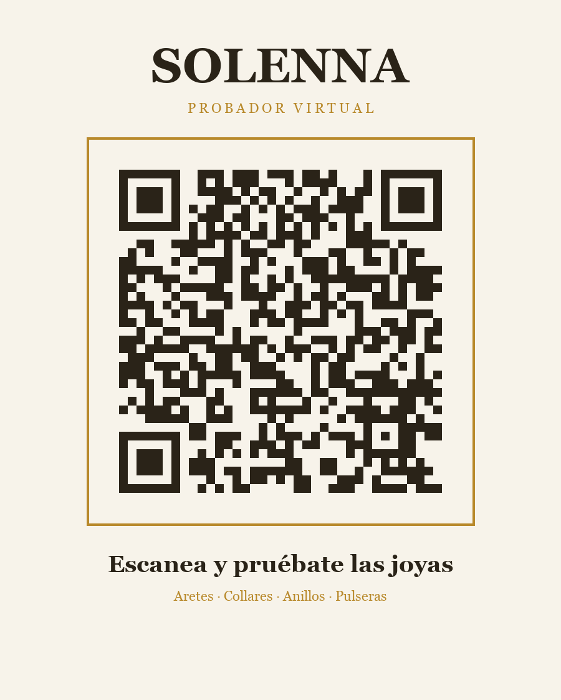

# Solenna · Probador virtual

Probador virtual de joyería que funciona en el navegador, sin instalar nada.
Usa la cámara o una foto subida + MediaPipe (gratis) para colocar aretes, collar, anillos y pulseras en tiempo real.

## 🌐 Sitio en vivo

**https://carlos-escandon-o.github.io/Solenna/**

Publicado con GitHub Pages (HTTPS, funciona desde el celular).

## ✨ Funciones

- **Dos modos:** cámara en vivo o subir una selfie guardada (ideal si no quieres abrir la cámara en el bazar).
- **Catálogo de 17 piezas**: 16 de ejemplo + 1 pieza real (Collar Vaquero, con imagen propia en `assets/`), con filtros **Oro / Plata / Perlas / Piedras** y orden por precio o nombre.
- **Ajuste manual** de posición y tamaño, dedo para anillos, muñeca para pulseras, y opción de subir tu propia joya en PNG.
- **Pedir por WhatsApp:** abre un chat con el nombre y precio de la pieza ya escritos.
- **Foto descargable** y botón compartir.
- **Contador social diario.**

## ⚙️ Configuración ( importante )

Al inicio del `<script>` en `index.html` hay dos valores que debes editar:

```js
const WHATSAPP = "525539753964";                  // configurado con tu número
const BASE_PRUEBAS_REALES_POR_PIEZA = {};         // solo con pruebas reales documentadas
```

1. **WHATSAPP:** ya está tu número (`52` + `55 3975 3964`). El botón abre el chat con el nombre y precio de la pieza ya escritos.
2. **Contador:** es **real y por pieza**: cuenta una prueba por sesión, se reinicia cada día y muestra qué pieza está siendo más probada (ej. *"💫 4 personas se lo probaron hoy · Collar Perla ×2"*). Las variaciones salen solas porque cada persona elige una joya distinta.
   Si llevas un registro **verdadero** de pruebas anteriores, puedes cargarlo como base, por ejemplo: `{ a1: 2, c3: 1, r2: 1 }`. Déjalo vacío si no: un cartel con números inventados se nota y rompe la confianza del cliente (además de ser publicidad engañosa).

## 📱 Cartel QR para el bazar



`cartel-qr-solenna.png` está listo para imprimir. Si cambias la URL, regenera:

```bash
python3 generar_qr.py   # requiere: pip install qrcode pillow
```

## 🔄 Cómo actualizar el sitio

Cada cambio en `index.html` se publica solo con:

```bash
git add . && git commit -m "describe el cambio" && git push
```

GitHub Pages tarda ~1 minuto en reflejarlo.

## 🔐 Panel de administración

**https://carlos-escandon-o.github.io/Solenna/admin.html**

El inventario vive en `catalogo.json`. El panel permite cambiar **nombre, tipo, categoría, precio, stock e imagen** de cada pieza, agregar o borrar piezas, y guardar directamente en el repo.

### Configuración (una sola vez)

1. En GitHub: **Settings → Developer settings → Personal access tokens → Fine-grained tokens**.
2. **Generate new token**: nombre `Solena Admin`, expiración la que prefieras.
3. Repository access → **Only select repositories** → `Solenna`.
4. Permissions → **Contents: Read and write**.
5. Copia el token (solo se muestra una vez).
6. Abre `/admin.html`, pega el token y tu repo (`Carlos-Escandon-O/Solenna`), y entra.

El token queda guardado **solo en ese navegador**. No se envía a ningún servidor propio: el panel habla directamente con la API de GitHub. Cualquier otra persona puede ver la página del panel, pero **sin tu token no puede guardar nada**.

> Si prefieres no usar tokens: edita `catalogo.json` directamente en GitHub y haz commit. La web lee ese archivo al cargar.

### Stock

- `stock: 0` → la pieza aparece como **Agotado** y el botón de WhatsApp se desactiva.
- Si el archivo JSON no carga (sin conexión), la web usa un catálogo interno de respaldo.

## 🧼 Preparar fotos automáticamente

Script que quita el fondo, separa piezas y ajusta medidas en un solo paso:

```bash
pip install -r requirements.txt
# pon tus fotos en fotos-crudas/ con prefijo según el tipo:
# aretes-...  collar-...  anillo-...  pulsera-...
python3 preparar_fotos.py
```

- Detecta **varias piezas en una misma foto** (islas de transparencia) y las guarda por separado.
- Escala a 600×1200 (aretes), 1200×1200 (collares), 1200×675 (anillos) o 1200×720 (pulseras).
- Guarda en `assets/` y escribe `catalogo-sugerido.json` con las entradas para el panel Admin.
- Para fotos con **varias pulseras juntas**, funciona siempre que no se toquen.
- Si la joya está sostenida por una mano o se toca con otra, recorta esa foto antes.

## 📸 Poner tus piezas reales

1. Foto de cada joya de frente, bien iluminada y centrada, con fondo liso o transparente (PNG). Yo puedo quitar el fondo si me la mandas.
2. Reemplaza el array `CATALOGO` en `index.html` con tus piezas reales: `nombre`, `tipo`, `cat`, `precio` y `src` con la ruta de la imagen. Ejemplo ya implementado:

```js
{ id:'c5', nombre:'Collar Vaquero', tipo:'collar', cat:'oro', precio:850, src:'assets/collar-vaquero.png' }
```

3. Con 5–10 piezas ya tienes el catálogo completo. Las imágenes van en `assets/` y se recortan con fondo transparente (ver `ESPECIFICACIONES_FOTOS.md`).

## Notas

- **Oclusión:** el cuello tapa la parte trasera del collar, y la muñeca o el dedo tapan la parte de atrás de pulseras y anillos, para que se vean puestos y no dibujados encima.
- El collar es aproximado (la malla facial no cubre el cuello), por eso tiene controles de ajuste. Aretes, anillos y pulseras son más precisos.
- Funciona mejor con buena luz y la cara o mano bien visibles.
- Las fotos que sube cada persona no se envían a ningún servidor: se procesan en su propio navegador.
- Librerías: MediaPipe Tasks Vision v0.10.14 (CDN). Sin costos ni API keys.
